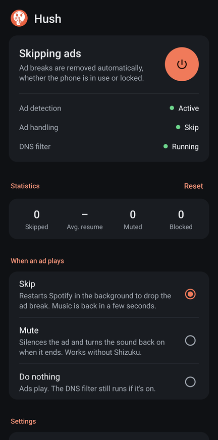
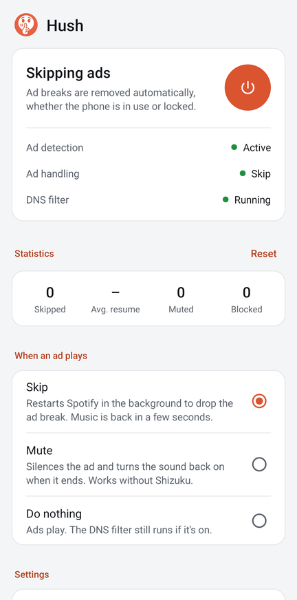
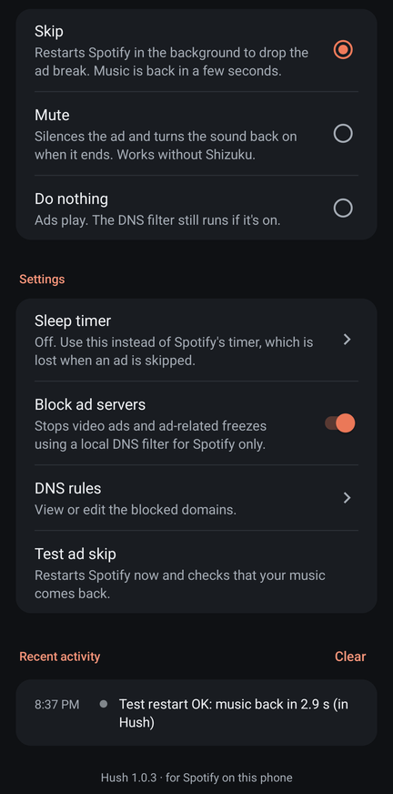
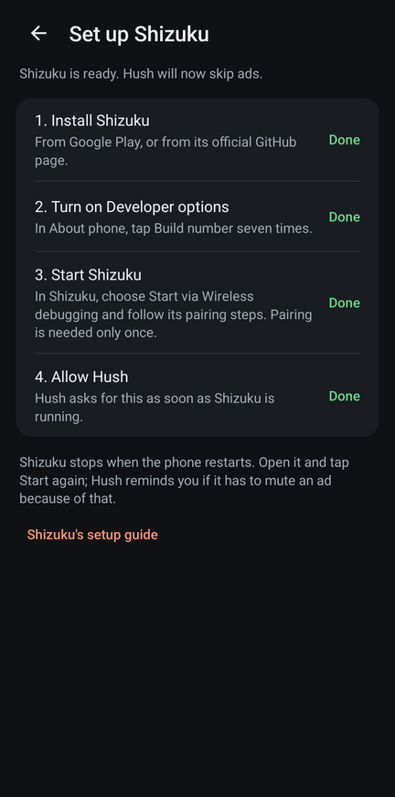
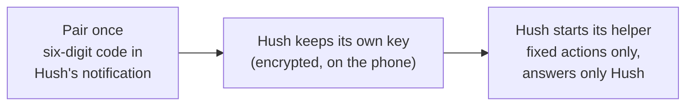
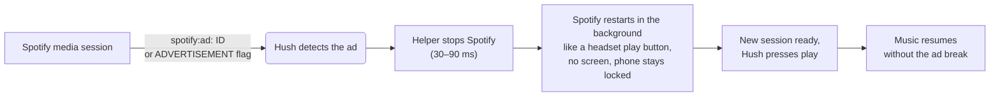
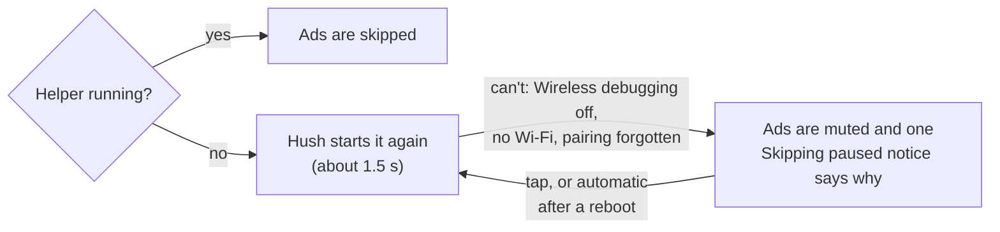

<div align="center">


# Hush

**Ad-free listening for Spotify on Android — no root, no modified Spotify app.**

[](https://github.com/coldMEW/Hush/releases/latest)
[](https://github.com/coldMEW/Hush/actions/workflows/build.yml)
[](LICENSE)


[Download](https://github.com/coldMEW/Hush/releases/latest) ·
[How it works](docs/HOW-IT-WORKS.md) ·
[Security](SECURITY.md) ·
[Changelog](CHANGELOG.md)

</div>

---

Hush runs alongside the official Spotify app. The moment Spotify starts an ad break, Hush restarts
Spotify in the background — which discards the entire break — and your music continues a few
seconds later. An optional on-device DNS filter, applied to Spotify only, can also remove video
ads and the playback freezes they cause.

Since 2.0 Hush is the only app you need: it pairs with Android's Wireless debugging by itself and
starts its own small helper. Shizuku still works if you already use it.

<p align="center">
  
  &nbsp;
  
  &nbsp;
  
  &nbsp;
  
</p>

## Features

| | |
| --- | --- |
| **Skips whole ad breaks** | Every ad is recognised from Spotify's own metadata — including the first ad of a multi-ad break — and music is back about 2 to 3 seconds later. |
| **Leaves your phone alone** | No screen wake-ups. A locked phone stays locked, the app you are using stays in front, and Spotify never pops up on screen when it was in the background. Its lock-screen controls come back right away. Music keeps playing with the screen off. |
| **Keeps your place** | If Spotify comes back on a different playlist or album after a restart, Hush switches back to the one you were playing. |
| **Sleep timer that survives skips** | Spotify's own timer is lost whenever Spotify restarts, so Hush has its own: 5 minutes to 1 hour, any custom time (hours, minutes, seconds), or end of song. |
| **Mute mode** | Prefer not to restart Spotify? Hush can mute ads instead, and does so automatically (with one notification) whenever skipping is not ready. |
| **Spotify-only DNS filter (optional)** | Off by default. Turn on **Block ad servers** to block video-ad hosts and the ad-asset host that can freeze background playback. Other apps and all non-DNS traffic are untouched. |
| **One app, guided setup** | Hush pairs with Wireless debugging itself: you type a six-digit code into its notification, once. No computer, no second app. |
| **Looks after itself** | If its helper stops, Hush starts it again. After a reboot one tap brings skipping back, or Hush does it by itself if you turn on automatic restart. |
| **Private** | No accounts, analytics or tracking. Nothing leaves the device (with the DNS filter on, only Spotify's own DNS lookups are forwarded). |

## How it works

**Once: setup.** Hush pairs with Android's Wireless debugging like a computer would, and starts
its own small helper with the same rights as `adb shell`. The helper answers only Hush and can
do only a fixed list of actions.



**Every ad break.** Spotify keeps an ad break only in memory, so a cold restart resumes the queue
at the next song.



**Looks after itself.** Skipping never stops without you being told.



The tricky parts (Spotify's media-button intent being cancelled by a force-stop, keeping the
screen state untouched, Android's background-audio rules, the pairing protocol and the reboot
handling) are documented with measurements in [docs/HOW-IT-WORKS.md](docs/HOW-IT-WORKS.md).

## Performance

Measured on one phone with Spotify 9.1 (free tier), real ads and test skips, against 1.0.3.
Numbers vary a little between phones.

| | 1.0.3 (with Shizuku) | 2.0 |
| --- | --- | --- |
| Apps to install | Hush + Shizuku | Hush only |
| Ad detected → Spotify stopped | 50–105 ms | 30–90 ms |
| Silence after a real ad | 2.2–2.8 s | 1.4–2.3 s |
| Silence after a test skip | 1.4–2.8 s | 1.2–2.0 s |
| Spotify's notification back | about 1 s | 0.2–1.1 s |
| Spotify shown on screen (when in the background) | never | never |
| After a reboot | open Shizuku, tap Start | automatic, about 4 s after unlocking (opt-in), or one tap |
| After a Hush update | — | ready again in 1–2 s |
| If the helper is stopped | Shizuku had to be restarted by hand | restarted by Hush in about 1.5 s |
| App size | 172 KB | 205 KB |

## Requirements

- Android 11 or newer and Wi-Fi to skip ads (Wireless debugging needs Wi-Fi, not internet).
  On Android 8 to 10 Hush can skip through [Shizuku](https://shizuku.rikka.app/) started from a
  computer, or mutes ads.
- The official [Spotify](https://play.google.com/store/apps/details?id=com.spotify.music) app (free tier)

## Setup video

Install and set up Hush from scratch in under a minute: pairing, permissions and the first
skipped ad.

https://github.com/user-attachments/assets/b7713aba-1956-459b-b680-6d76fd52765b

## Installation

1. Download **`Hush-<version>.apk`** from the [latest release](https://github.com/coldMEW/Hush/releases/latest)
   and open it. Allow installing from your browser if Android asks.
2. Open Hush and tap the **power button**. Hush asks for what it needs, one step at a time:

   | Permission | Why |
   | --- | --- |
   | Notification access | Read Spotify's "now playing" information to recognise ads. Android calls this "notification read, reply & control"; Hush doesn't read your notifications |
   | VPN (only if you turn on **Block ad servers**) | The local DNS filter (Spotify's DNS lookups only) |
   | Wireless debugging (pair once) | Start Hush's helper, which restarts Spotify when an ad starts |
   | Notifications | Status, a **Turn off** button, and problem alerts |
   | Unrestricted battery | Keep working while the phone is locked |

3. Hush opens **Set up skipping**. It takes about two minutes, once:
   1. **Turn on Developer options:** tap **Open**, then tap **Build number** seven times (in
      About phone). Come back to Hush.
   2. **Pair Hush:** tap **Pair**. Hush opens Developer options. Turn on **Wireless debugging**
      (allow it on your Wi-Fi), open it and tap **Pair device with pairing code**.
   3. Pull down the notification shade. In Hush's notification **Enter the pairing code**, tap
      **Enter code** and type the six digits shown in Settings. Hush pairs and starts its helper;
      the notification changes to **Skipping is ready**.

   Some phone makers need one extra switch in Developer options; Hush shows that step only on
   those phones. Already using Shizuku? Hush uses it too, and you can skip this.
4. Back in Hush, allow **Notification access** and **Unrestricted battery** when asked.
5. Optional: turn on **Restart automatically after a reboot**. Hush tests once (about 10 seconds)
   whether your phone keeps its helper running with Wireless debugging off, keeps it off if so,
   and shows the result.
6. Play something on Spotify and tap **Test ad skip** to hear the music come back.

> [!TIP]
> **Updating from 1.0.x?** Install the new APK over the old one; your settings are kept and
> skipping keeps working through Shizuku. To drop Shizuku, tap **Set up** next to **Skip without
> Shizuku** in Hush, pair once, then uninstall Shizuku.

> [!NOTE]
> Android turns Wireless debugging off when the phone restarts. With automatic restart on, Hush
> takes care of it by itself a few seconds after you unlock the phone (Android 13+). Without it,
> Hush shows one **Skipping paused** notification: tap it and Hush turns Wireless debugging back
> on and resumes. (On Android 11 and 12 Hush may not switch it itself: the tap shows where to turn
> it on, and skipping resumes as soon as it is on.) Until then, ads are muted, not played.

## Usage

- **Power button** — turns Hush on or off. The notification also has a **Turn off** button.
- **When an ad plays** — *Skip* (restart Spotify), *Mute*, or *Do nothing*.
- **Sleep timer** — use this instead of Spotify's timer; it survives ad skips.
- **DNS rules** — view or edit the filter (`block`, `nxdomain`, `redirect`, `ip`, `upstream`).
- **Restart automatically after a reboot** — Hush brings skipping back by itself after a restart
  (Android 13+). Turn it off and on again to repeat the phone test.
- **Test ad skip** — restarts Spotify now, to check that your music comes back.
- **Recent activity** — every ad break, skip and change, with timings. If Hush's helper can't
  start, the reason is shown here too.

## Troubleshooting

<details>
<summary><b>Ads are muted instead of skipped</b></summary>

Skipping is not ready: usually Wireless debugging is off after a reboot, or the phone is not on
Wi-Fi. Tap Hush's notification, or open Hush — the status card says what is missing. If Hush asks to
pair again, Android has forgotten the pairing (it does that for pairings unused for 7 days unless
**Disable adb authorization timeout** is on in Developer options).
</details>

<details>
<summary><b>Copy diagnostics</b></summary>

Settings → **Copy diagnostics** copies a short report (phone maker and model, Android version,
how Hush skips, the last helper errors) for a bug report. It has nothing about what you listen to, and Hush never
sends it anywhere by itself.
</details>

<details>
<summary><b>Music does not come back after a skip</b></summary>

Use **Test ad skip** to reproduce it. Hush retries once and then shows a notification; tapping it
opens Spotify. Make sure Hush has unrestricted battery use.
</details>

<details>
<summary><b>Removing Hush or its pairing</b></summary>

Uninstalling Hush also stops its helper. The pairing stays listed under Developer options →
Wireless debugging → **Paired devices** as "Hush"; tap it and **Forget** to remove it too.
</details>

<details>
<summary><b>"Another VPN app took over"</b></summary>

Android allows one VPN at a time. Hush's ad skipping keeps working without its DNS filter; turn
**Block ad servers** off, or stop the other VPN.
</details>

## Known issues

- Restoring the previous playlist works for playlists and albums, not for an artist's
  "Popular" list.

## Privacy & security

Hush holds two powerful capabilities — adb-level rights through its own helper (or Shizuku) and a
VPN — and is built so neither can be misused: the helper answers only Hush and runs only a fixed
list of actions, every value passed to it is validated and quoted, the DNS
forwarder accepts replies only from its resolver, all data stays in private storage and is
excluded from backups, and release builds do not log what you play. Details, and how to report a
vulnerability privately, are in [SECURITY.md](SECURITY.md).

## Building from source

Requires JDK 17 and the Android SDK (API 35).

```bash
git clone https://github.com/coldMEW/Hush.git
cd Hush/android
./gradlew testDebugUnitTest      # unit tests
./gradlew assembleDebug          # debug build (installs alongside a release build)
./gradlew assembleRelease        # release build, see signing below
```

Release builds are signed with a key that is not in this repository. To sign your own, create
`~/.gradle/hush-signing.properties` (or set `HUSH_SIGNING` to another path):

```properties
storeFile=/path/to/keystore.jks
storePassword=…
keyAlias=…
keyPassword=…
```

Without it, `assembleRelease` produces an unsigned APK.

### Project layout

```
android/app/src/main/java/io/coldmew/hush/
├── AdWatcher.java          notification listener: reads Spotify's media session, detects ads
├── Skipper.java            the restart-skip: force-stop, restart, resume
├── SleepTimer.java         Hush's own sleep timer
├── DnsVpnService.java      Spotify-only DNS filter (VpnService)
├── Dns.java, Rules.java    DNS packet handling and rules
├── Shell.java              one entry point: Hush's helper, else Shizuku
├── HelperControl.java      starts and watches the helper, reboot and per-phone test
├── HelperSetupActivity     guided pairing with Wireless debugging
├── PairingService.java     finds the pairing port, takes the code from the notification
├── adb/                    small adb client: key, pairing (SPAKE2), TLS connection, mDNS
├── helper/                 the helper process and its fixed command table
├── MainActivity.java       main screen
├── ShizukuSetupActivity    guided Shizuku setup (optional)
└── Hush.java, Prefs.java, Events.java, …
docs/HOW-IT-WORKS.md        design notes and measurements
```

## Roadmap

- [x] v1.0.1 — no audio gap after skips, including with the phone locked
- [x] v1.0.2 — no silent playback when Android freezes the restarted Spotify
- [x] v1.0.3 — Spotify stays off screen during a skip, and its controls come back right away
- [x] v2.0.0 — one app: no Shizuku needed, self-healing, optional automatic restart after a reboot
- [ ] ESP32 companion with similar features for speakers and other devices

## Contributing

Found a bug or have an idea? [Open an issue](https://github.com/coldMEW/Hush/issues/new/choose):
bugs and feature requests are handled in public. Pull requests are welcome too; see
[CONTRIBUTING.md](CONTRIBUTING.md). Security vulnerabilities are the one exception: please report
those privately as described in [SECURITY.md](SECURITY.md).

## Disclaimer

Hush is an independent project. It is not affiliated with, endorsed by or connected to Spotify AB;
Spotify is a trademark of Spotify AB. Blocking ads may be against Spotify's terms of service — use
Hush at your own risk. If you enjoy Spotify, consider supporting artists with Spotify Premium.

## License

Hush is free software, released under the [GNU General Public License v3.0](LICENSE).
