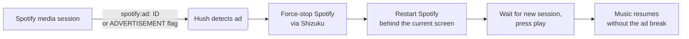

<div align="center">


# Hush

**Ad-free listening for Spotify on Android — no root, no modified Spotify app.**

[](https://github.com/coldMEW/Hush/releases/latest)
[](https://github.com/coldMEW/Hush/actions/workflows/build.yml)
[](LICENSE)


[Download](https://github.com/coldMEW/Hush/releases/latest) ·
[How it works](docs/HOW-IT-WORKS.md) ·
[Security](SECURITY.md) ·
[Changelog](CHANGELOG.md)

</div>

---

Hush runs alongside the official Spotify app. The moment Spotify starts an ad break, Hush restarts
Spotify in the background — which discards the entire break — and your music continues a few
seconds later. A small on-device DNS filter, applied to Spotify only, also removes video ads and
the playback freezes they cause.

<p align="center">
  
  &nbsp;
  
  &nbsp;
  
  &nbsp;
  
</p>

## Features

| | |
| --- | --- |
| **Skips whole ad breaks** | Every ad is recognised from Spotify's own metadata — including the first ad of a multi-ad break — and the break is dropped in about 4 seconds. |
| **Leaves your phone alone** | No screen wake-ups. A locked phone stays locked, the app you are using stays in front, and Spotify goes back to the background if that is where it was. Music keeps playing with the screen off. |
| **Keeps your place** | If Spotify comes back on a different playlist or album after a restart, Hush switches back to the one you were playing. |
| **Sleep timer that survives skips** | Spotify's own timer is lost whenever Spotify restarts, so Hush has its own: 5 minutes to 1 hour, or end of song. |
| **Mute mode** | Prefer not to restart Spotify? Hush can mute ads instead, and does so automatically when Shizuku is not running. |
| **Spotify-only DNS filter** | Blocks video-ad hosts and the ad-asset host that freezes background playback. Other apps and all non-DNS traffic are untouched. |
| **Guided setup** | A step-by-step screen installs and starts Shizuku, ticking off each step as it completes. |
| **Private** | No accounts, analytics or tracking. Nothing leaves the device except Spotify's own DNS lookups. |

## How it works



Spotify keeps an ad break only in memory, so a cold restart resumes the queue at the next song.
The tricky parts — Spotify's media-button intent being cancelled by a force-stop, keeping the
screen state untouched, Android's background-audio rules — are documented with measurements in
[docs/HOW-IT-WORKS.md](docs/HOW-IT-WORKS.md).

## Requirements

- Android 8.0 or newer (wireless Shizuku start needs Android 11+)
- The official [Spotify](https://play.google.com/store/apps/details?id=com.spotify.music) app (free tier)
- [Shizuku](https://shizuku.rikka.app/) — to restart Spotify. Without it, Hush mutes ads instead.

## Installation

1. Download **`Hush-<version>.apk`** from the [latest release](https://github.com/coldMEW/Hush/releases/latest)
   and open it. Allow installing from your browser if Android asks.
2. Open Hush and tap the **power button**. Hush asks for what it needs, one step at a time:

   | Permission | Why |
   | --- | --- |
   | Notification access | Read Spotify's "now playing" information to recognise ads |
   | VPN | The local DNS filter (Spotify's DNS lookups only) |
   | Shizuku | Restart Spotify when an ad starts |
   | Notifications | Status, a **Turn off** button, and problem alerts |
   | Unrestricted battery | Keep working while the phone is locked |

3. If Shizuku is not set up yet, Hush opens **Set up Shizuku** and guides you through installing
   it, enabling Developer options, starting it with Wireless debugging and allowing Hush.
4. Tap **Test ad skip** to confirm your music comes back on your headphones or speaker.

> [!NOTE]
> Shizuku (without root) stops whenever the phone restarts. Open Shizuku and tap **Start** after a
> reboot. If Hush has to mute an ad because Shizuku is not running, it shows a reminder.

## Usage

- **Power button** — turns Hush on or off. The notification also has a **Turn off** button.
- **When an ad plays** — *Skip* (restart Spotify), *Mute*, or *Do nothing*.
- **Sleep timer** — use this instead of Spotify's timer; it survives ad skips.
- **DNS rules** — view or edit the filter (`block`, `nxdomain`, `redirect`, `ip`, `upstream`).
- **Recent activity** — every ad break, skip and change, with timings.

## Troubleshooting

<details>
<summary><b>Ads are muted instead of skipped</b></summary>

Shizuku is not running (usually after a reboot) or Hush is not allowed to use it. Open Hush — the
status card says which — and follow the **Set up Shizuku** steps.
</details>

<details>
<summary><b>Music does not come back after a skip</b></summary>

Use **Test ad skip** to reproduce it. Hush retries once and then shows a notification; tapping it
opens Spotify. Make sure Hush has unrestricted battery use.
</details>

<details>
<summary><b>"Another VPN app took over"</b></summary>

Android allows one VPN at a time. Hush's ad skipping keeps working without its DNS filter; turn
**Block ad servers** off, or stop the other VPN.
</details>

## Known issues

- Restoring the previous playlist works for playlists and albums, not for an artist's
  "Popular" list.

## Privacy & security

Hush holds two powerful capabilities — an adb-level shell through Shizuku and a VPN — and is built
so neither can be misused: every value passed to the shell is validated and quoted, the DNS
forwarder accepts replies only from its resolver, all data stays in private storage and is
excluded from backups, and release builds do not log what you play. Details, and how to report a
vulnerability privately, are in [SECURITY.md](SECURITY.md).

## Building from source

Requires JDK 17 and the Android SDK (API 35).

```bash
git clone https://github.com/coldMEW/Hush.git
cd Hush/android
./gradlew testDebugUnitTest      # unit tests
./gradlew assembleDebug          # debug build (installs alongside a release build)
./gradlew assembleRelease        # release build, see signing below
```

Release builds are signed with a key that is not in this repository. To sign your own, create
`~/.gradle/hush-signing.properties` (or set `HUSH_SIGNING` to another path):

```properties
storeFile=/path/to/keystore.jks
storePassword=…
keyAlias=…
keyPassword=…
```

Without it, `assembleRelease` produces an unsigned APK.

### Project layout

```
android/app/src/main/java/io/coldmew/hush/
├── AdWatcher.java          notification listener: reads Spotify's media session, detects ads
├── Skipper.java            the restart-skip: force-stop, restart, resume, restore the screen
├── SleepTimer.java         Hush's own sleep timer
├── DnsVpnService.java      Spotify-only DNS filter (VpnService)
├── Dns.java, Rules.java    DNS packet handling and rules
├── Shell.java              Shizuku shell with argument validation
├── MainActivity.java       main screen
├── ShizukuSetupActivity    guided Shizuku setup
└── Hush.java, Prefs.java, Events.java, …
docs/HOW-IT-WORKS.md        design notes and measurements
```

## Roadmap

- [x] v1.0.1 — no audio gap after skips, including with the phone locked
- [x] v1.0.2 — no silent playback when Android freezes the restarted Spotify
- [ ] ESP32 companion with similar features for speakers and other devices

## Contributing

Bug reports and pull requests are welcome — see [CONTRIBUTING.md](CONTRIBUTING.md). For security
issues, please use private reporting as described in [SECURITY.md](SECURITY.md).

## Disclaimer

Hush is an independent project. It is not affiliated with, endorsed by or connected to Spotify AB;
Spotify is a trademark of Spotify AB. Blocking ads may be against Spotify's terms of service — use
Hush at your own risk. If you enjoy Spotify, consider supporting artists with Spotify Premium.

## License

Hush is free software, released under the [GNU General Public License v3.0](LICENSE).
